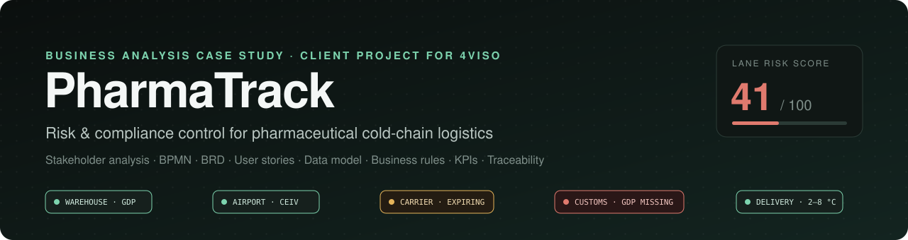
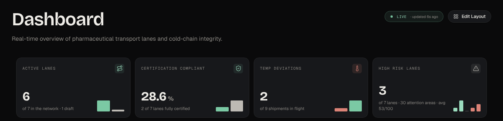
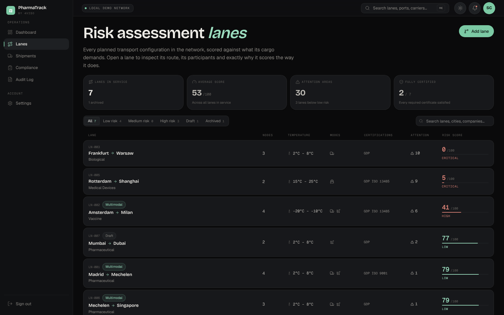
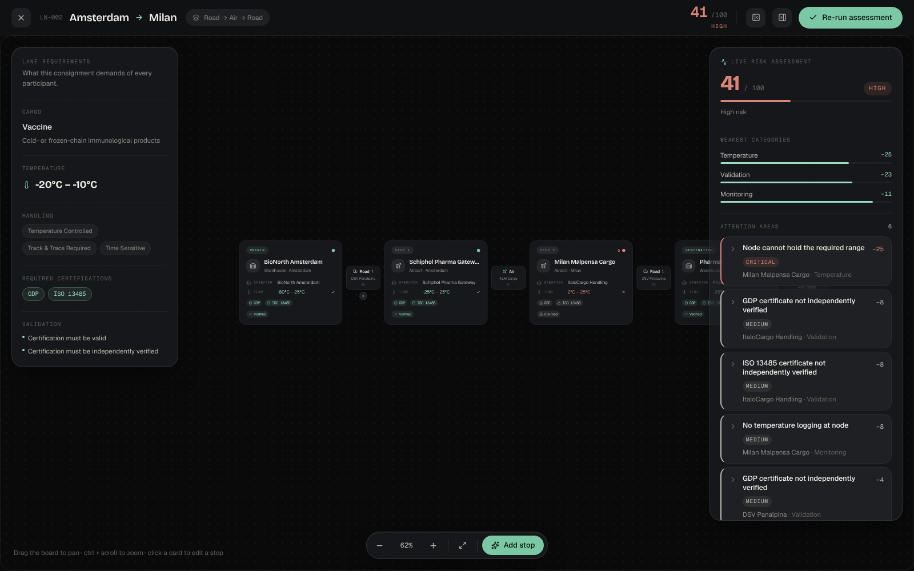
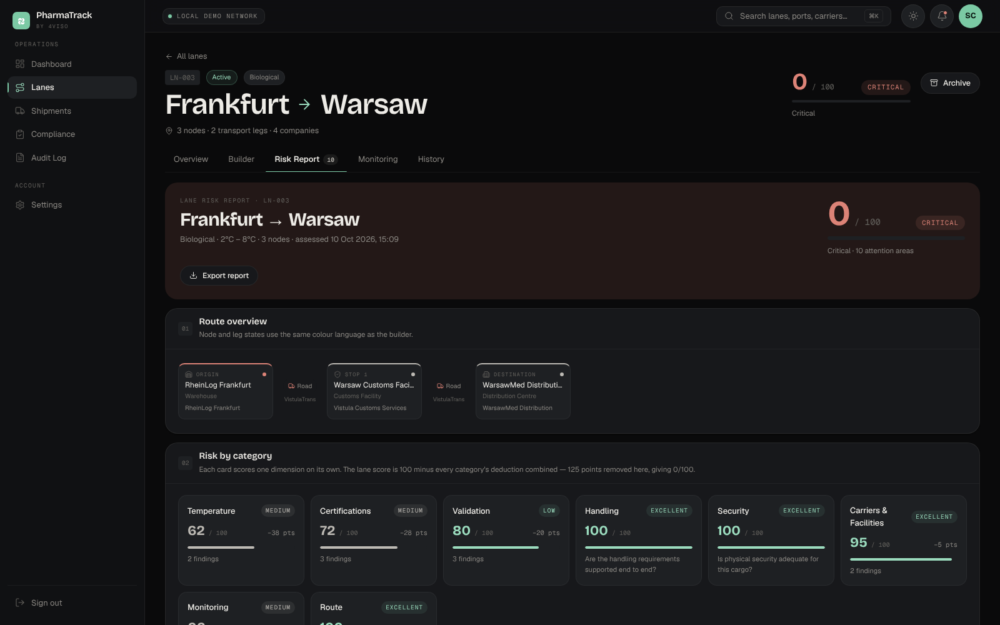
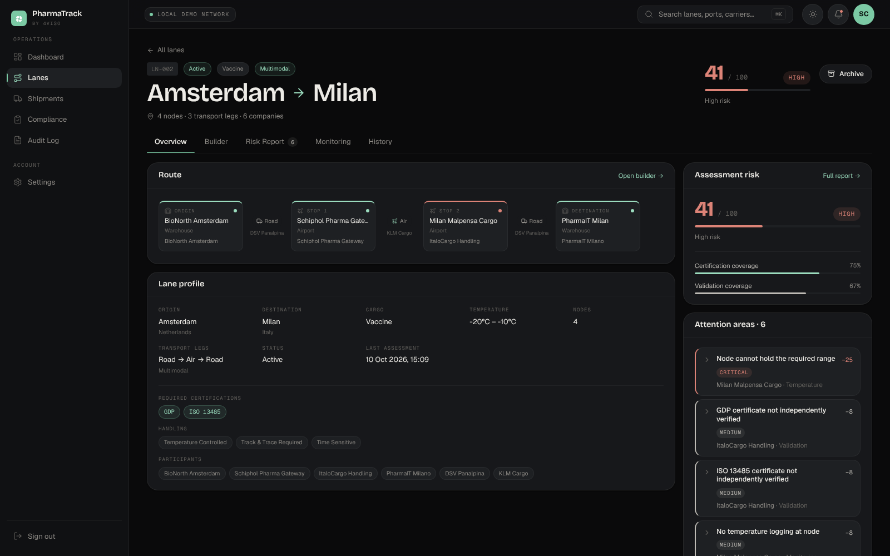
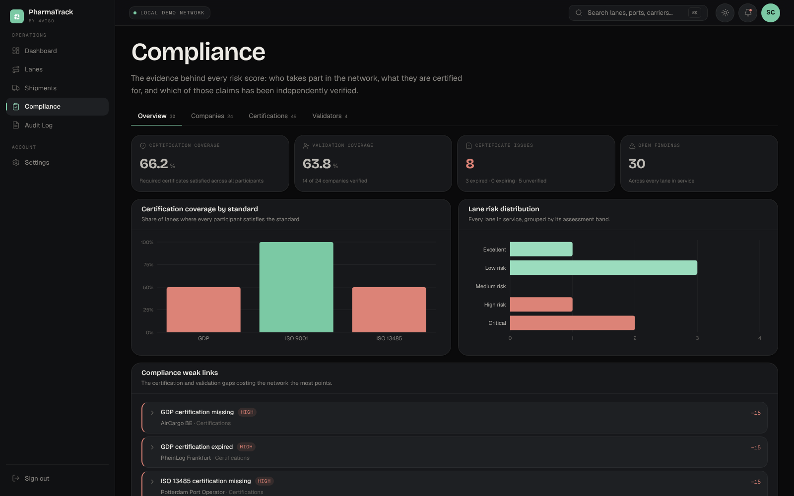
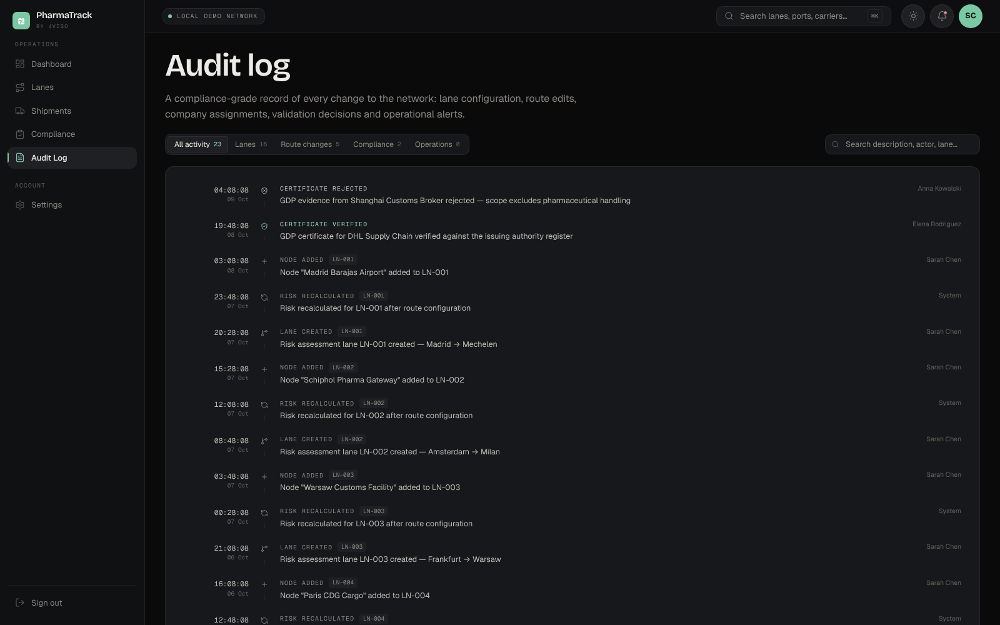

  

  
  
  
  
  

  <b><a href="https://frontend-progect-lab-4-viso.vercel.app/dashboard">▶ Live demo</a></b> ·
  <a href="#-the-analysis">The analysis</a> ·
  <a href="#-screens">Screens</a> ·
  <a href="#-my-role">My role</a>

---

## 📌 In one paragraph

**4Viso**, a Belgian compliance and risk-assessment company, needed a way to control pharmaceutical shipments that pass through many companies, countries and transport modes. I led a four-person student team that worked directly with 4Viso's CEO across **four requirements sessions**, turned his verbal vision (*"show me the supply chain as a chain of blocks I can act on"*) into a structured set of requirements, and delivered a working platform. It models every lane as a chain of nodes and legs, checks every link against EU GDP expectations, scores the lane with **explainable** risk rules and keeps an **immutable audit trail**. 4Viso reused the team's code and concepts in its own development.

This repository is the **business-analysis side** of that project: the documents a BA produces, from the business case to the traceability matrix.

## 📊 At a glance

| | | | |
|:---:|:---:|:---:|:---:|
| **4** stakeholder sessions with the CEO | **9** stakeholders mapped | **3** BPMN process models | **5** roles × 7 permissions |
| **30 + 10** functional + non-functional requirements | **21** user stories · 92 story points | **30+** risk rules in 8 categories | **29 / 30** functional requirements delivered |

## 🧩 The problem → the solution

| Before (AS-IS) | After (TO-BE with PharmaTrack) |
|---|---|
| Partner certificates collected by e-mail and checked one PDF at a time | One certificate register per company, validity checked automatically |
| Risk scored in a spreadsheet, differently by every analyst | 30+ business rules, one score, every point explained with a recommended action |
| Temperature logger read **after** delivery | Excursion alerts **during** transit, critical when > 2 °C outside the band |
| Decisions buried in inboxes | Append-only audit log, exportable as CSV for regulators |

  
   TO-BE process: lane creation and risk assessment (BPMN 2.0). More in <a href="docs/03-process-models.md">03 · Process Models</a>.

## 📚 The analysis

| # | Document | What it shows | BA technique |
|:---:|---|---|---|
| 01 | [**Business Case & Scope**](docs/01-business-case.md) | Client context, problem statement, 5 business objectives, in/out of scope | Problem framing, SMART objectives |
| 02 | [**Stakeholder Analysis**](docs/02-stakeholders.md) | Register, power/interest grid, engagement plan, the 4 sessions, personas | Stakeholder mapping |
| 03 | [**Process Models**](docs/03-process-models.md) | AS-IS vs TO-BE, pain points, alert & certificate lifecycles | BPMN 2.0, state diagrams |
| 04 | [**Requirements (BRD)**](docs/04-requirements.md) | 5 business, 30 functional, 10 non-functional requirements | MoSCoW, requirement sourcing |
| 05 | [**User Stories**](docs/05-user-stories.md) | 6 epics, 21 stories, acceptance criteria, definition of done | Story mapping, Gherkin |
| 06 | [**Roles & Permissions**](docs/06-roles-and-permissions.md) | 5 roles × 7 permissions, segregation of duties | RBAC matrix |
| 07 | [**Data Model**](docs/07-data-model.md) | 13 business entities and why a lane became a graph | ERD |
| 08 | [**Risk Rules**](docs/08-risk-rules.md) | Scoring policy, decision table, worked example | Business rules, decision tables |
| 09 | [**KPIs**](docs/09-kpis.md) | Dashboard KPIs with formulas, proposed phase-2 KPIs | KPI definition |
| 10 | [**Traceability Matrix**](docs/10-traceability.md) | Objective → requirement → story → delivery → test | RTM |
| 11 | [**Retrospective**](docs/11-retrospective.md) | What worked, what I would change, phase-2 roadmap | Lessons learned |

## 🖥️ Screens

  

<table>
  <tr>
    <td width="50%"> <b>Lane portfolio.</b> Every lane scored 0–100 against what its cargo demands.</td>
    <td width="50%"> <b>Lane builder.</b> The "chain of blocks" the CEO asked for, with live risk assessment.</td>
  </tr>
  <tr>
    <td width="50%"> <b>Risk report.</b> Score per category; every deduction traceable to a finding.</td>
    <td width="50%"> <b>Lane overview.</b> Route, requirements, participants and attention areas.</td>
  </tr>
  <tr>
    <td width="50%"> <b>Compliance.</b> Certificate and validation coverage across the network.</td>
    <td width="50%"> <b>Audit log.</b> Append-only record of every change, for GDP audits.</td>
  </tr>
</table>

Screens show the platform's bundled demo network. No confidential 4Viso data is included in this repository.

## 👤 My role

**Project manager and analyst** in a four-person student team (May – Aug 2026), plus database and backend.

- Ran the **four requirements sessions** with 4Viso's CEO and kept scope decisions moving.
- Translated verbal needs into **requirements, workflows and a role model**: what each node and leg must prove, who may change what, when an alert is critical.
- Designed the data model around the CEO's "chain of blocks" idea: a lane is a **graph of nodes and legs**, not a single row (see [07 · Data Model](docs/07-data-model.md#3-why-a-graph-not-a-single-row-per-lane)).
- Designed the **database, data pipelines and backend** that implement those rules; coordinated delivery with the frontend developer.
- Presented the **acceptance demo** (healthy → disputed → critical lane) to 4Viso management.

## 💡 Three decisions that shaped the product

1. **Model the chain, not the shipment.** Remodelling lanes as nodes and legs is what lets the platform point at the *exact* failing link.
2. **Explain every point.** A score is useless to a customer without a reason and an action, so every finding carries both, and the total always adds up.
3. **Make the audit log untouchable.** Append-only at database level, because a compliance trail that an admin can edit is not a compliance trail.

## 🛠️ Delivered system

`Next.js` · `TypeScript` · `Node.js / Express` · `Supabase (PostgreSQL, Auth, Row-Level Security)` · `Zod` · deployed on `Vercel`

## 📝 A note on this documentation

During the project the requirements were agreed **verbally** with the CEO and captured in the team's notes and in the system itself. This repository documents them in standard BA form **after delivery**, based on the stakeholder sessions and the delivered platform. Writing it up was also my main lesson learned: next time, the one-page decision summary goes out after every session, not at the end ([11 · Retrospective](docs/11-retrospective.md)).

---

  <b>Kostiantyn Dolyna</b> · International Business Management (Applied Data Intelligence), Thomas More, Belgium 
  Looking for a <b>Business Analyst internship</b> from February 2027

