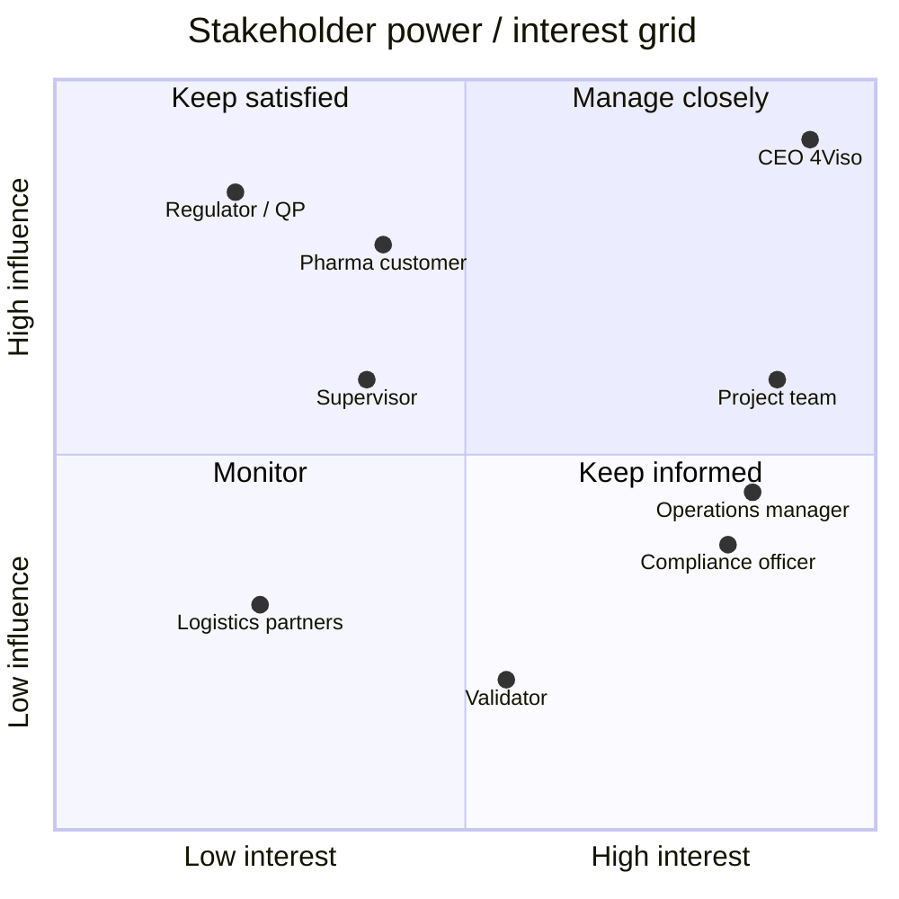

# 02 · Stakeholder Analysis

> **Document purpose:** identify everyone who influences or is affected by PharmaTrack, and decide how to engage each of them.

---

## 1. Stakeholder register

| # | Stakeholder | Type | Interest in PharmaTrack | Influence | Interest |
|---|---|---|---|---|---|
| S1 | **CEO, 4Viso** | Sponsor, product owner | Product vision, commercial value, reuse of the solution | High | High |
| S2 | **Operations manager** (4Viso) | Primary user | Building lanes, assigning companies, reacting to delays | Medium | High |
| S3 | **Compliance officer** (4Viso) | Primary user | Certificate status, GDP compliance, audit exports | Medium | High |
| S4 | **Independent validator** | Secondary user | Verifying or rejecting certificates and capabilities | Low | Medium |
| S5 | **Pharma customer** (shipper) | Beneficiary | Safe delivery, evidence of compliance | High | Medium |
| S6 | **Logistics partners** (carriers, handlers, customs brokers) | Data providers | Their certificates and capabilities are assessed | Medium | Low |
| S7 | **Regulator / Qualified Person** | External | Traceable, tamper-proof records | High | Low |
| S8 | **University supervisor** | Academic | Process quality, grading | Medium | Medium |
| S9 | **Student project team** (4) | Delivery team | Delivering a working MVP on time | Medium | High |

## 2. Power / interest grid

## 3. Engagement plan

| Stakeholder | Strategy | Channel | Frequency |
|---|---|---|---|
| CEO, 4Viso | **Manage closely:** co-define scope, validate every increment | Requirements sessions, demo | 4 sessions over the project + final presentation |
| Operations & compliance users | **Keep informed:** represented through personas and the CEO's domain knowledge | Personas, user stories, demo scenarios | Every sprint review |
| Pharma customer, regulator | **Keep satisfied:** requirements derived from EU GDP guidelines | Non-functional requirements, audit log | Design time |
| University supervisor | **Keep satisfied** | Progress reports | Bi-weekly |
| Project team | **Manage closely** | Stand-ups, task board | Several times a week |

## 4. Requirements sessions with the CEO

| Session | Focus | Key outcome |
|---|---|---|
| **#1 · Discovery** | The business problem, how lanes are assessed today | Supply chain modelled as a *chain of blocks*; each block must be actionable |
| **#2 · Scope** | What the MVP must do, what is out | Lane builder, certificates, temperature, alerts, audit log in scope; live IoT integration out |
| **#3 · Review** | Walk-through of the first working build | Risk must be *explainable* (finding + recommended action), not just a number; roles needed |
| **#4 · Acceptance** | Final demo with three scripted scenarios | Accepted; 4Viso reused the team's code and concepts in its own development |

## 5. User personas

<table>
<tr>
<td width="33%" valign="top">

### 🧭 Olivia, Operations Manager
**Goal:** get a new lane live quickly and keep shipments moving.
**Pain:** chases partners by e-mail for documents; learns about delays late.
**Needs from PharmaTrack:** a visual lane builder, company assignment, one view of all delayed or at-risk lanes.

</td>
<td width="33%" valign="top">

### 🛡️ Marc, Compliance Officer
**Goal:** prove that every lane is GDP-compliant.
**Pain:** certificates expire unnoticed; audit evidence is scattered.
**Needs from PharmaTrack:** certificate register with expiry warnings, explainable risk report, exportable audit trail.

</td>
<td width="33%" valign="top">

### ✅ Sofia, Independent Validator
**Goal:** confirm or reject the evidence partners submit.
**Pain:** no single queue of items waiting for review.
**Needs from PharmaTrack:** a list of claimed certificates and capabilities to verify, with her decision logged.

</td>
</tr>
</table>

---

⬅️ Previous: [01 · Business Case](01-business-case.md) · ➡️ Next: [03 · Process Models](03-process-models.md)
