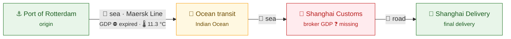
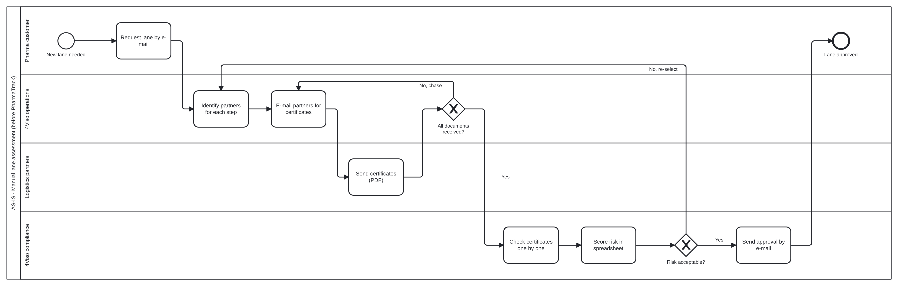
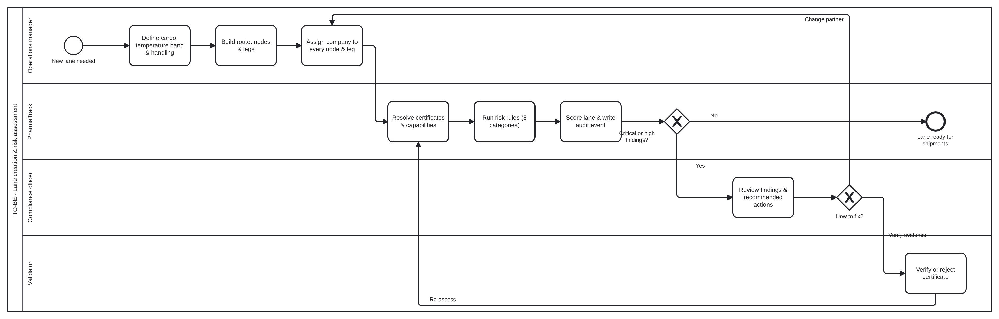
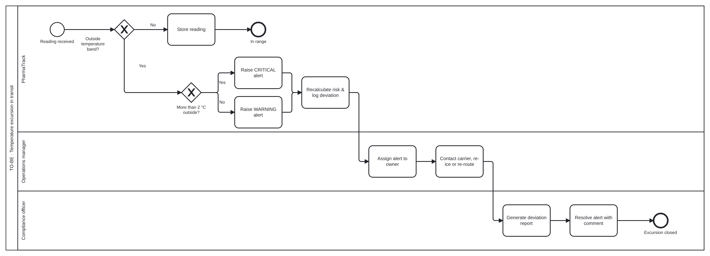
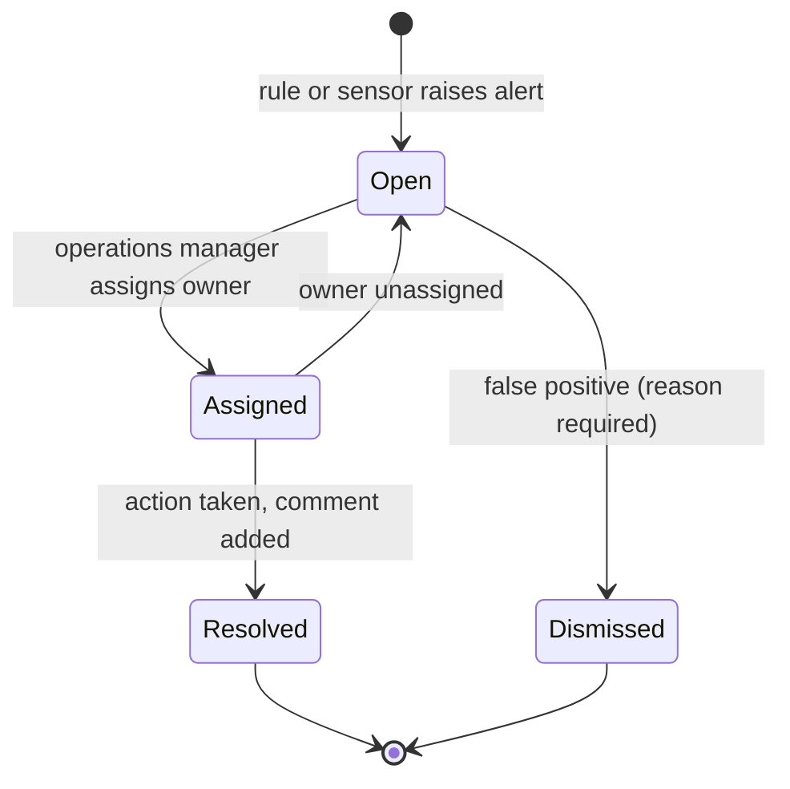
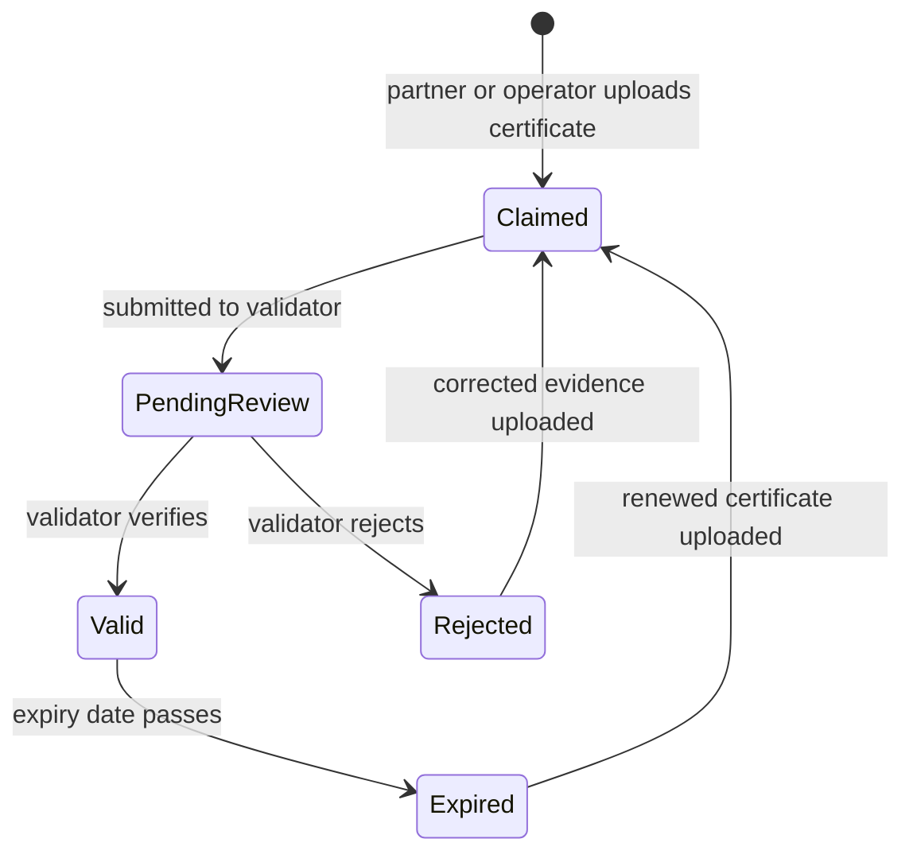

# 03 · Process Models (AS-IS → TO-BE)

> **Document purpose:** show how lane risk is handled today, where it breaks, and how PharmaTrack changes the process.
> Process diagrams use **BPMN 2.0** notation. The source `.bpmn` files are in [`/diagrams`](../diagrams) and open in [bpmn.io](https://demo.bpmn.io) or Camunda Modeler. Domain and lifecycle diagrams are drawn in Mermaid.

---

## 1. The domain in one picture

A **lane** is a planned route for a pharmaceutical product. It is a chain of **nodes** (places where goods are stored or handed over) linked by **legs** (transport between two nodes). Every node and leg is operated by a **company** that holds **certifications**.

*Demo lane LN-003, Rotterdam → Shanghai, 2–8 °C: an expired carrier certificate, an uncertified customs broker and a failing reefer on the ocean leg. These are exactly the gaps the CEO wanted to see at a glance.*

---

## 2. AS-IS · Manual lane assessment

Source: [`as-is-manual-lane-assessment.bpmn`](../diagrams/as-is-manual-lane-assessment.bpmn)

Two loops make this process slow and unpredictable: **chasing partners** for missing documents, and **re-selecting partners** after the spreadsheet score fails. Neither loop has an owner or a deadline, and the temperature data is only read *after* delivery.

### Pain points

| # | Pain point | Consequence | Addressed by |
|---|---|---|---|
| P1 | Partner evidence collected by e-mail | Days of chasing; no overview of what is missing | Lane builder + certificate register ([FR-01 – FR-03](04-requirements.md#31-lane-management), [FR-10](04-requirements.md#33-certifications--validation)) |
| P2 | Certificates checked manually | Expired or expiring certificates slip through | Automatic validity checks ([FR-12](04-requirements.md#33-certifications--validation)) |
| P3 | Risk scored in a spreadsheet | Inconsistent between analysts, not explainable to the customer | Rule-based risk engine ([FR-14 – FR-18](04-requirements.md#34-risk-assessment)) |
| P4 | Temperature data read after delivery | Excursions discovered when it is too late to act | In-transit monitoring and alerts ([FR-19 – FR-23](04-requirements.md#35-monitoring--alerts)) |
| P5 | Decisions live in inboxes | Weak audit trail for regulators | Append-only audit log ([FR-24 – FR-26](04-requirements.md#36-audit-reporting--dashboard)) |

---

## 3. TO-BE · Lane creation & risk assessment

Source: [`to-be-lane-risk-assessment.bpmn`](../diagrams/to-be-lane-risk-assessment.bpmn)

**What changed:** partner evidence lives in one register, so the system checks it in seconds instead of operations chasing it by e-mail. The two loops still exist, but now each has an owner (compliance or validator), a reason (a named finding) and an audit trail. Segregation of duties is built into the lanes: the person who picks a partner is not the person who verifies its certificate.

## 4. TO-BE · Temperature excursion in transit

Source: [`to-be-temperature-excursion.bpmn`](../diagrams/to-be-temperature-excursion.bpmn)

**What changed:** an excursion becomes an alert *during* transit, with a severity the team can act on (more than 2 °C outside the band is critical), instead of a finding in a post-delivery report.

## 5. Alert lifecycle

## 6. Certificate lifecycle

---

⬅️ Previous: [02 · Stakeholders](02-stakeholders.md) · ➡️ Next: [04 · Requirements](04-requirements.md)
