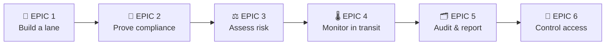

# 05 · User Stories & Acceptance Criteria

> **Document purpose:** express the requirements from the user's point of view, in a form the development team can build and test against.
> **Format:** *As a [role], I want [capability], so that [benefit].* Acceptance criteria in Given / When / Then. Story points on a Fibonacci scale.

---

## Story map



| Epic | Stories | Must | Should | Could | Points |
|---|:---:|:---:|:---:|:---:|:---:|
| 1 · Build a lane | 4 | 3 | 1 | – | 18 |
| 2 · Prove compliance | 4 | 4 | – | – | 16 |
| 3 · Assess risk | 3 | 3 | – | – | 21 |
| 4 · Monitor in transit | 4 | 3 | – | 1 | 16 |
| 5 · Audit & report | 4 | 2 | 2 | – | 13 |
| 6 · Control access | 2 | 2 | – | – | 8 |
| **Total** | **21** | **17** | **3** | **1** | **92** |

---

## EPIC 1 · Build a lane

### US-01 · Create a lane · `M` · 3 pts · → FR-01
**As an** operations manager **I want** to create a lane with its cargo type, temperature band and handling requirements **so that** every later check knows what "good" means for this product.

```gherkin
Scenario: Create a cold-chain lane
  Given I am signed in as an operations manager
  When I create lane "LN-023" for cargo "Vaccine" with temperature band "2 °C – 8 °C"
  Then the lane is saved with status "active"
  And an audit event "LANE_CREATED" is recorded with my name
```

### US-02 · Build the route visually · `M` · 8 pts · → FR-02, FR-05
**As an** operations manager **I want** to add, remove and reorder nodes on a canvas **so that** the lane looks like the real supply chain.

```gherkin
Scenario: Add a customs node between two ports
  Given lane "LN-023" has nodes "Port of Rotterdam" and "Shanghai Delivery"
  When I insert a "Customs Facility" node between them
  Then the route shows three nodes connected by two legs
  And an audit event "NODE_ADDED" is recorded

Scenario: Detect a broken route
  Given a lane whose last node has no incoming leg
  When the risk assessment runs
  Then a finding "ROUTE_BROKEN" is shown with the recommended action to connect the node
```

### US-03 · Assign companies · `M` · 5 pts · → FR-03, FR-07
**As an** operations manager **I want** to assign a company to every node and a carrier to every leg **so that** the system can check who is responsible for each link.

```gherkin
Scenario: Carrier does not operate the leg's mode
  Given a "sea" leg on lane "LN-023"
  When I assign carrier "Lufthansa Cargo", which only operates "air"
  Then the finding "CARRIER_MODE_MISMATCH" is raised for that leg
```

### US-04 · See lanes on a map · `S` · 2 pts · → FR-04
**As an** operations manager **I want** to see all active lanes on a world map coloured by status **so that** I can spot problem regions at a glance.

---

## EPIC 2 · Prove compliance

### US-05 · Register a certificate · `M` · 3 pts · → FR-10, FR-11
**As a** compliance officer **I want** to upload a company's certificate with its issue and expiry date **so that** the lane assessment can rely on it.

```gherkin
Scenario: New certificate starts unverified
  Given company "Turkish Cargo" has no GDP certificate
  When I add a GDP certificate valid until 2027-03-31
  Then its status is "claimed"
  And the lane assessment shows "UNVERIFIED_GDP" until a validator confirms it
```

### US-06 · Be warned before a certificate expires · `M` · 3 pts · → FR-12
**As a** compliance officer **I want** certificates expiring within 60 days to be flagged **so that** I can request renewals in time.

```gherkin
Scenario: Certificate inside the 60-day window
  Given the GDP certificate of "Maersk Line" expires in 45 days
  When any lane using "Maersk Line" is assessed
  Then a finding "EXPIRING_GDP" explains that it expires in 45 days

Scenario: Certificate past its expiry date
  Given the GDP certificate of "Maersk Line" expired yesterday
  When the lane is assessed
  Then a finding "EXPIRED_GDP" with severity "high" is raised
```

### US-07 · Validate evidence · `M` · 5 pts · → FR-13
**As a** validator **I want** a queue of claimed certificates and capabilities **so that** I can verify or reject them with one decision each.

```gherkin
Scenario: Validator rejects a certificate
  Given a GDP certificate in status "pending review"
  When I reject it with the reason "Scope does not cover cold storage"
  Then its status becomes "rejected"
  And an audit event "CERTIFICATE_REJECTED" stores my name and reason
  And every lane using that company is re-assessed
```

### US-08 · Compliance overview · `M` · 5 pts · → FR-26
**As a** compliance officer **I want** one overview of companies, certificates and validators **so that** I can see the compliance position of the whole network.

---

## EPIC 3 · Assess risk

### US-09 · Automatic risk score · `M` · 8 pts · → FR-14, FR-16, FR-17
**As a** compliance officer **I want** every lane scored 0–100 across 8 categories **so that** I compare lanes objectively instead of by gut feeling.

```gherkin
Scenario: Clean lane
  Given every node and leg of lane "LN-001" is assigned, certified, verified and temperature-capable
  When the lane is assessed
  Then its score is 90 or higher and its level is "excellent"

Scenario: Score is explainable
  Given any assessed lane
  Then the overall score equals 100 minus the sum of the category deductions shown in the report
```

### US-10 · Explain each finding · `M` · 5 pts · → FR-15, FR-27
**As a** compliance officer **I want** every finding to explain the problem and recommend an action **so that** I can tell the customer *why* a lane is risky and *what* to do.

### US-11 · Re-assess on every change · `M` · 8 pts · → FR-18
**As an** operations manager **I want** the score to update as soon as I change a node, company or certificate **so that** I see the effect of my decision immediately.

---

## EPIC 4 · Monitor in transit

### US-12 · Record temperature readings · `M` · 3 pts · → FR-19, FR-20
**As the** system **I want** to store each temperature reading with its source **so that** the cold chain can be proven afterwards.

### US-13 · Raise excursion alerts · `M` · 5 pts · → FR-21
**As an** operations manager **I want** an alert the moment a shipment leaves its band **so that** I can act before the product is lost.

```gherkin
Scenario Outline: Alert severity follows the size of the excursion
  Given lane "LN-003" with temperature band 2 °C – 8 °C
  When a reading of <value> °C is received
  Then an alert with severity "<severity>" is raised

  Examples:
    | value | severity |
    | 9.5   | warning  |
    | 11.3  | critical |
    | 1.2   | warning  |
    | -0.5  | critical |
```

### US-14 · Work an alert to closure · `M` · 5 pts · → FR-22
**As an** operations manager **I want** to assign, resolve or dismiss an alert with a comment **so that** nothing stays open without an owner.

```gherkin
Scenario: Resolve an alert
  Given an open critical temperature alert on "LN-003"
  When I assign it to myself and later resolve it with "Reefer reset, deviation report filed"
  Then its status is "resolved"
  And an audit event "ALERT_RESOLVED" records the comment
```

### US-15 · Choose my notifications · `C` · 3 pts · → FR-23
**As a** user **I want** to choose which alerts reach me and through which channel **so that** I am not flooded with noise.

---

## EPIC 5 · Audit & report

### US-16 · Immutable audit log · `M` · 5 pts · → FR-24, FR-25
**As a** compliance officer **I want** every action logged and unchangeable **so that** I can show a regulator a trustworthy history.

```gherkin
Scenario: Admin tries to delete an audit entry
  Given I am signed in as an admin
  When I try to delete an audit event through the API
  Then the request is refused by the database policy
  And the entry is still present
```

### US-17 · Export evidence · `M` · 3 pts · → FR-26
**As a** compliance officer **I want** to export the audit log and compliance overview to CSV **so that** I can attach them to an audit file.

### US-18 · Lane risk report · `S` · 3 pts · → FR-27
**As a** compliance officer **I want** a printable report per lane **so that** I can share the assessment with the customer.

### US-19 · Portfolio dashboard · `S` · 2 pts · → FR-28
**As the** CEO **I want** KPIs for active lanes, compliance, excursions and high-risk lanes **so that** I see the health of the whole portfolio in one screen.

---

## EPIC 6 · Control access

### US-20 · Sign in · `M` · 3 pts · → FR-29
**As a** user **I want** to sign in securely **so that** only authorised people see shipment data.

### US-21 · Role-based permissions · `M` · 5 pts · → FR-30
**As an** admin **I want** each user to get one of five roles **so that** people can only perform the actions they are responsible for.

```gherkin
Scenario: Validator cannot edit a lane
  Given I am signed in as a validator
  When I open lane "LN-009"
  Then the edit, route and shipment controls are not available
  But I can still verify certificates and read the audit log
```

---

## Definition of Done

- Acceptance criteria demonstrated on seeded demo data
- Every state change writes an audit event
- Input validated (schema) on the API
- Role restrictions enforced in the UI; audit-log immutability enforced in the database
- Reviewed by a second team member
- Shown to the stakeholder in the next session

---

⬅️ Previous: [04 · Requirements](04-requirements.md) · ➡️ Next: [06 · Roles & Permissions](06-roles-and-permissions.md)
