# 07 · Data Model

> **Document purpose:** describe the business entities PharmaTrack manages and how they relate. This is the logical model the analysis produced; it was implemented as 14 PostgreSQL tables.

---

## 1. Entity-relationship diagram

```mermaid
erDiagram
    LANE ||--o{ NODE : "is a chain of"
    LANE ||--o{ LANE_SEGMENT : "is connected by"
    NODE ||--o{ LANE_SEGMENT : "starts / ends"
    COMPANY ||--o{ NODE : "is responsible for"
    COMPANY ||--o{ LANE_SEGMENT : "carries"
    COMPANY ||--o{ CERTIFICATION : "holds"
    VALIDATOR ||--o{ CERTIFICATION : "verifies"
    PROFILE ||--o| VALIDATOR : "acts as"
    LANE ||--o{ SHIPMENT : "is used by"
    PACKAGE_PROFILE ||--o{ SHIPMENT : "describes"
    SHIPMENT ||--o{ TEMPERATURE_READING : "is measured by"
    NODE ||--o{ TEMPERATURE_READING : "is measured at"
    LANE ||--o{ ALERT : "raises"
    SHIPMENT ||--o{ ALERT : "raises"
    PROFILE ||--o{ ALERT : "is assigned"
    PROFILE ||--o{ AUDIT_LOG : "performs"
    LANE ||--o{ AUDIT_LOG : "is subject of"
    LANE ||--o{ DOCUMENT : "has"
    COMPANY ||--o{ DOCUMENT : "has"

    LANE {
        string code "LN-001"
        string origin_destination
        string mode "air, sea, road, multi"
        string status "active ... archived"
        decimal temp_min_max "e.g. 2-8 C"
        int risk_score "0-100"
        string risk_level
        string compliance_status
    }
    NODE {
        int sequence
        string type "warehouse, airport, port, hub, customs, final_delivery"
        string location
        string validation_status
        string security_level
    }
    LANE_SEGMENT {
        string mode "air, sea, road"
        string status "on_track ... critical"
    }
    COMPANY {
        string name
        string type "carrier, warehouse, forwarder, handler, port operator, customs broker"
        string_array temperature_capabilities
        string security_level
        bool monitoring_systems
    }
    CERTIFICATION {
        string type "GDP, CEIV Pharma, ISO ..."
        date valid_from
        date valid_until
        string status "claimed ... expired"
    }
    VALIDATOR {
        string name
        string organization
        bool can_verify_certifications
    }
    SHIPMENT {
        string status "loading ... delivered"
        int progress
        datetime eta
    }
    TEMPERATURE_READING {
        decimal value
        datetime recorded_at
        string source "sensor, manual, carrier_api"
    }
    ALERT {
        string type "temperature, certification, delay ..."
        string severity "info, warning, critical"
        string status "open, assigned, resolved, dismissed"
    }
    AUDIT_LOG {
        string action "LANE_CREATED ..."
        datetime created_at
        json details
    }
    PROFILE {
        string name
        string role "admin ... viewer"
    }
    PACKAGE_PROFILE {
        string goods_type
        string cooling_type "passive, active"
    }
    DOCUMENT {
        string type "GDP_certificate, temperature_report ..."
        string url
    }
```

## 2. Entity glossary

| Entity | Business meaning | Key rule |
|---|---|---|
| **Lane** | A planned route for a product between an origin and a destination | Carries the requirements every participant is checked against |
| **Node** | A place where goods are stored, handled or handed over | Ordered by `sequence`; one responsible company |
| **Lane segment (leg)** | Transport between two consecutive nodes | One carrier and one mode; the mode must fit both locations |
| **Company** | Any logistics participant | Capabilities are *claims* until a validator verifies them |
| **Certification** | Evidence that a company meets a standard | Only `valid` and verified certificates satisfy a lane fully |
| **Validator** | Independent reviewer | Decisions are logged with name and time |
| **Shipment** | One physical consignment travelling a lane | Tracks its current node and progress |
| **Temperature reading** | One measurement during transit | Never edited; deviations derived from the lane band |
| **Alert** | Something that needs a human decision | Must end `resolved` or `dismissed` with an owner |
| **Audit log** | Immutable record of every state change | Insert-only, at database level |
| **Document** | Supporting file (certificate, bill of lading, temperature report) | Linked to the entity it proves |

## 3. Why a graph, not a single row per lane

The first technical brief modelled a lane as **one row** with an origin, a destination and one carrier. During session #1 the CEO described lanes as *"a chain of blocks, each of which I need to act on"*. That changed the model:

| | First brief | Final model |
|---|---|---|
| Lane | 1 row, 1 carrier | 1 row + N nodes + N–1 legs |
| Responsibility | One carrier for the whole route | One company per node and per leg |
| Risk | One number from 5 inputs | Findings per node and leg, across 8 categories |
| Certificates | `gdp_certified` yes/no on the carrier | Certificate register with validity and verification |

This was the single most important analysis decision of the project: it turned a tracking dashboard into a tool that can point to the *exact link* in the chain that is failing.

---

⬅️ Previous: [06 · Roles & Permissions](06-roles-and-permissions.md) · ➡️ Next: [08 · Risk Rules](08-risk-rules.md)
