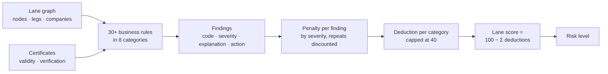

# 08 · Risk Assessment Rules

> **Document purpose:** specify, in business terms, how PharmaTrack turns the state of a lane into a risk score. The CEO's requirement from session #3 drove the design: *"a number alone is useless to my customer — tell them what is wrong and what to do about it."*

---

## 1. How a lane is scored

**Direction:** a lane starts at **100** and loses points for every finding. **Higher is safer.**

## 2. Policy parameters

| Parameter | Value | Why |
|---|---|---|
| Starting score | 100 | A lane with no findings is fully trusted |
| Penalty per finding | critical **25** · high **15** · medium **8** · low **3** · info **0** | Severity drives cost |
| Repeated defect | 1st occurrence full penalty, 2nd ½, 3rd ⅓ … (min. 1 point) | Six nodes sharing one gap should not drive a lane to zero and hide every other signal |
| Category cap | max. **40** points lost per category | A lane failing one category badly still scores above a lane failing three |
| Expiring-soon window | **60 days** | Covers the lifetime of shipments planned on the lane |

All parameters live in one policy file, so 4Viso can tune them without rewriting rules ([NFR-09](04-requirements.md#4-non-functional-requirements)).

## 3. Risk levels

| Score | Level | Meaning for the user |
|:---:|---|---|
| 90 – 100 | 🟢 **Excellent** | Ready to ship |
| 75 – 89 | 🟢 **Low** | Ship; review minor findings |
| 50 – 74 | 🟡 **Medium** | Needs attention before the next shipment |
| 25 – 49 | 🔴 **High** | Do not ship until the high findings are resolved |
| 0 – 24 | 🔴 **Critical** | Lane unsafe |

## 4. Rule catalogue (decision table)

| Category | Rule code | Condition | Severity |
|---|---|---|:---:|
| 🌡️ **Temperature** | `TEMP_NO_CONTROL` | Node offers no temperature control on a controlled lane | Critical |
| | `TEMP_RANGE_INSUFFICIENT` | Node cannot hold the lane's band | Critical |
| | `TEMP_SEGMENT_NO_CONTROL` | Transport leg is uncontrolled | Critical |
| | `TEMP_SEGMENT_RANGE` | Carrier's range does not cover the band | High |
| | `TEMP_CAPABILITY_UNKNOWN` / `TEMP_SEGMENT_UNKNOWN` | Capability not stated | Medium |
| 📜 **Certifications** | `MISSING_<type>` | Required certificate not on record | High |
| | `EXPIRED_<type>` | Certificate past its expiry date | High |
| | `EXPIRING_<type>` | Expires within 60 days | Medium |
| ✅ **Validation** | `CAPABILITY_REJECTED` | Validator rejected the company's claims | High |
| | `NODE_VALIDATION_REJECTED` | Node validation rejected | High |
| | `UNVERIFIED_<type>` | Valid certificate, not independently verified | Medium |
| | `CAPABILITY_UNVERIFIED` / `NODE_VALIDATION_EXPIRED` | Claims not verified / validation out of date | Medium |
| 📦 **Handling** | `HANDLING_<requirement>` | Fragile, dangerous goods, perishable … not supported | Critical → Low (by requirement) |
| 🔒 **Security** | `SECURITY_INSUFFICIENT` | High-value cargo, secure storage too weak | High |
| | `SECURITY_UNKNOWN` / `NO_SECURE_STORAGE` / `SEGMENT_SECURITY_LOW` | Security not stated, not offered, or low on a leg | Medium |
| 🏢 **Carriers & facilities** | `NODE_UNASSIGNED` / `SEGMENT_UNASSIGNED` | No company on a node or leg | High |
| | `CARRIER_MODE_MISMATCH` | Carrier does not operate the leg's mode | Medium |
| | `CARRIER_PERFORMANCE` | Carrier performance below target | Low |
| 📡 **Monitoring** | `NO_TRACK_AND_TRACE` | Track & trace required but missing on a leg | High |
| | `NO_TEMPERATURE_SENSORS` / `TRACKING_UNKNOWN` | No temperature logging / tracking not stated | Medium |
| | `NODE_NO_TRACK_AND_TRACE` / `NO_REALTIME_MONITORING` / `NO_SHOCK_MONITORING` | Visibility gaps | Low |
| 🗺️ **Route** | `ROUTE_INCOMPLETE` | Lane has fewer than two nodes | Critical |
| | `ROUTE_BROKEN` | Gap between consecutive nodes | High |
| | `MODE_LOCATION_MISMATCH` | Mode does not fit the locations (e.g. sea leg into an inland warehouse) | Medium |
| | `ROUTE_MANY_HANDOVERS` | Many handovers on a time-critical lane | Low |

Every finding is shown to the user with a **plain-language explanation** and a **recommended action**, for example:

> **EXPIRED_GDP** · *High* · Certifications
> *The GDP certificate of Maersk Line expired on 14/09/2026 and no longer satisfies the lane requirement.*
> **Recommended action:** Request the renewed GDP certificate from Maersk Line, or reassign this participant.

## 5. Worked example (illustrative)

A 2–8 °C sea lane with these findings:

| Finding | Category | Severity | Points |
|---|---|:---:|:---:|
| `EXPIRED_GDP` (carrier) | Certifications | High | 15 |
| `MISSING_GDP` (customs broker) | Certifications | High | 15 |
| `UNVERIFIED_GDP` (origin port) | Validation | Medium | 8 |
| `UNVERIFIED_GDP` (destination) | Validation | Medium | 4 *(2nd occurrence, ½)* |
| `TEMP_SEGMENT_RANGE` (ocean leg) | Temperature | High | 15 |
| `NO_REALTIME_MONITORING` | Monitoring | Low | 3 |

| Category | Deduction | Category score |
|---|:---:|:---:|
| Certifications | 30 | 70 |
| Temperature | 15 | 85 |
| Validation | 12 | 88 |
| Monitoring | 3 | 97 |
| All others | 0 | 100 |
| **Lane** | **60** | **100 − 60 = 40 → 🔴 High** |

The lane score always equals 100 minus the deductions printed in the report, so a customer can add the columns up and get the same number ([NFR-04](04-requirements.md#4-non-functional-requirements)).

---

⬅️ Previous: [07 · Data Model](07-data-model.md) · ➡️ Next: [09 · KPIs](09-kpis.md)
